# Pitch tipping from broadcast video

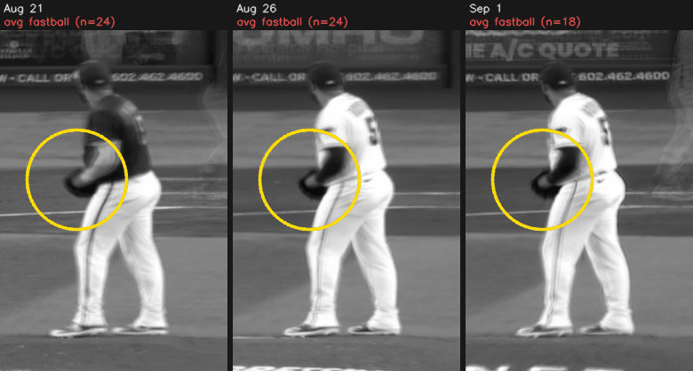

Pitch tipping is a high-leverage problem in baseball: a small change in a
pitcher's set position can tell the other team what pitch is coming, which
is a significant advantage.

Teams already look for this with far more data than I have. Sports
Illustrated [reported in 2023](https://www.si.com/mlb/2023/06/05/pitch-tipping-examples-technology-cameras-paranoid)
that ballpark camera systems running machine learning were finding
pitchers' tells, and Max Muncy [said in 2026](https://www.forbes.com/sites/peterchawaga/2026/10/11/dodgers-star-max-muncy-reveals-ai-programs-used-to-spot-pitch-tipping/)
that he had heard of teams using AI programs that point out differences in
glove and hand position. Every MLB ballpark has
[Statcast's Hawk-Eye system](https://www.mlb.com/glossary/statcast), 12
cameras that track the ball, its spin and the players' bodies.

I wanted to see what I could find by fully automating the search with only
the public broadcast.

Put simply, the pipeline matches up the still moment before each pitch,
sorts those frames by pitch type, averages them, and compares the averages
pixel by pixel.

The results were stronger than expected. Even with just public data, it
was possible to find a number of pitchers who were tipping. Of the first
few dozen scanned, more than 10% had an actionable tell.

## How it works

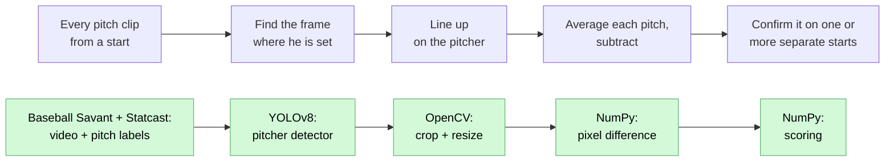

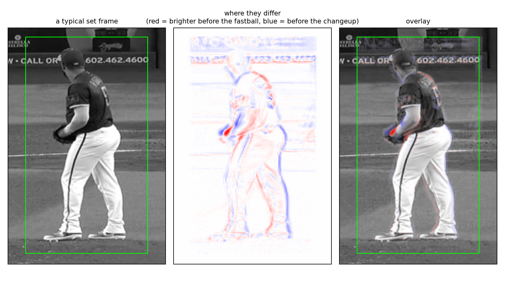

<details>
<summary>More pitchers</summary>

**Joey Cantillo**, fastball vs curveball, Jul 29 to Aug 21 2026

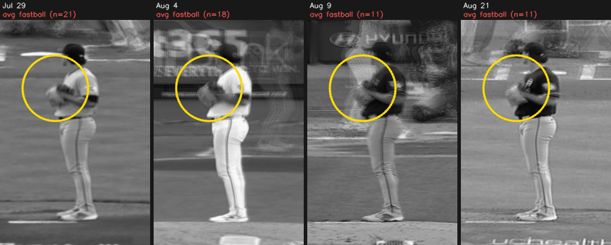
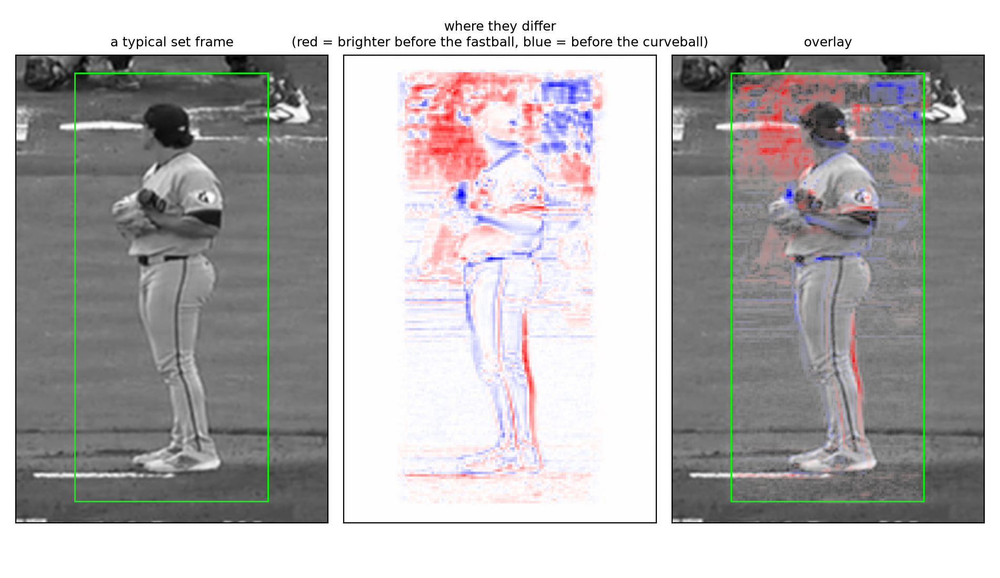

**Peter Lambert**, fastball vs changeup, Aug 20 to Aug 31 2026

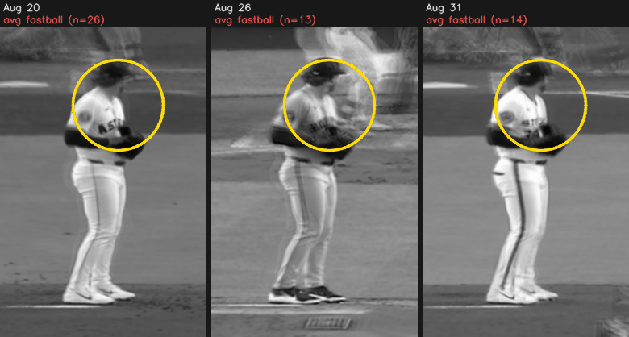
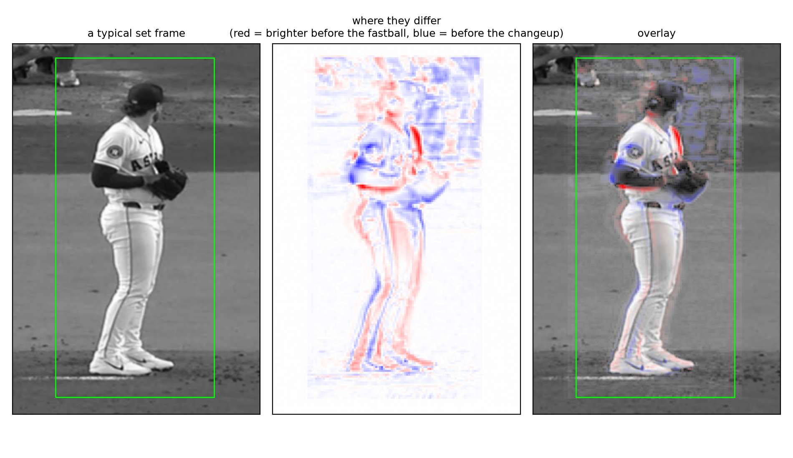

**Freddy Peralta**, fastball vs changeup, Jul 26 to Aug 21 2026

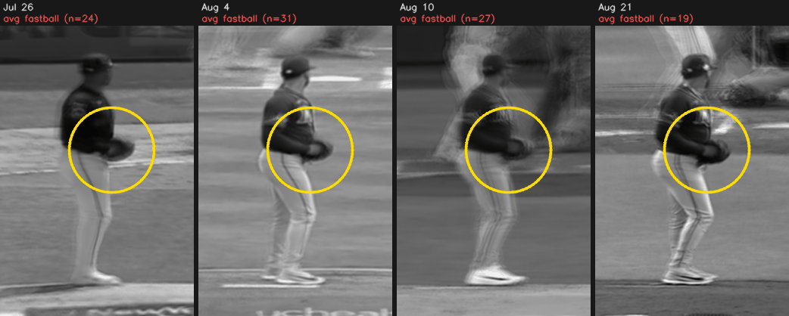
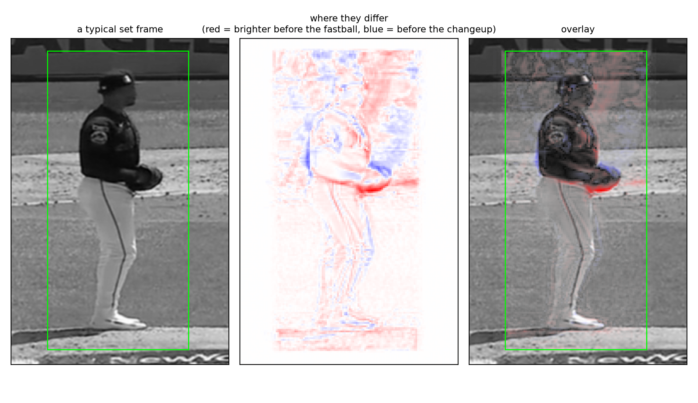

</details>

## Results

| Pitcher | Pitches | Tell | Score | Background |
|---|---|---|---|---|
| Rodriguez, 2026 | fastball vs changeup | glove position | 76% | 49% |
| Lambert, 2026 | fastball vs changeup | shoulder and hand position | 70% | 55% |
| Peralta, 2026 | fastball vs changeup | hand position | 62% | 58% |
| Cantillo, 2026 | fastball vs curveball | glove height | 60% | 43% |
| Glasnow, 2019 | fastball vs curveball | glove position | 67% | 57% |

Score is how often the method tells the two pitches apart on a separate
start. Background is the same test with the pitcher blanked out. The scan
covered about thirty pitchers; the table shows those that passed the
checks, along with a 2019 test on Glasnow.

Generally, when the score comes back high, the tell can be confirmed
visually with the heat map.

## Tells change over time

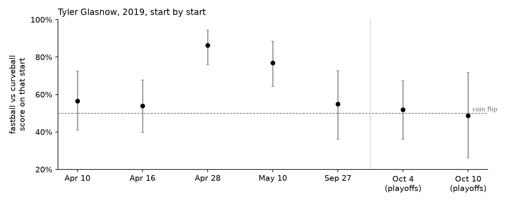

Tyler Glasnow's 2019 starts show a tell appearing and then being corrected.

## Learnings and future work

Pose estimation was expected to be the more informative representation.
Its scores were comparable, but for differences this small the pixel
difference proved easier to interpret.

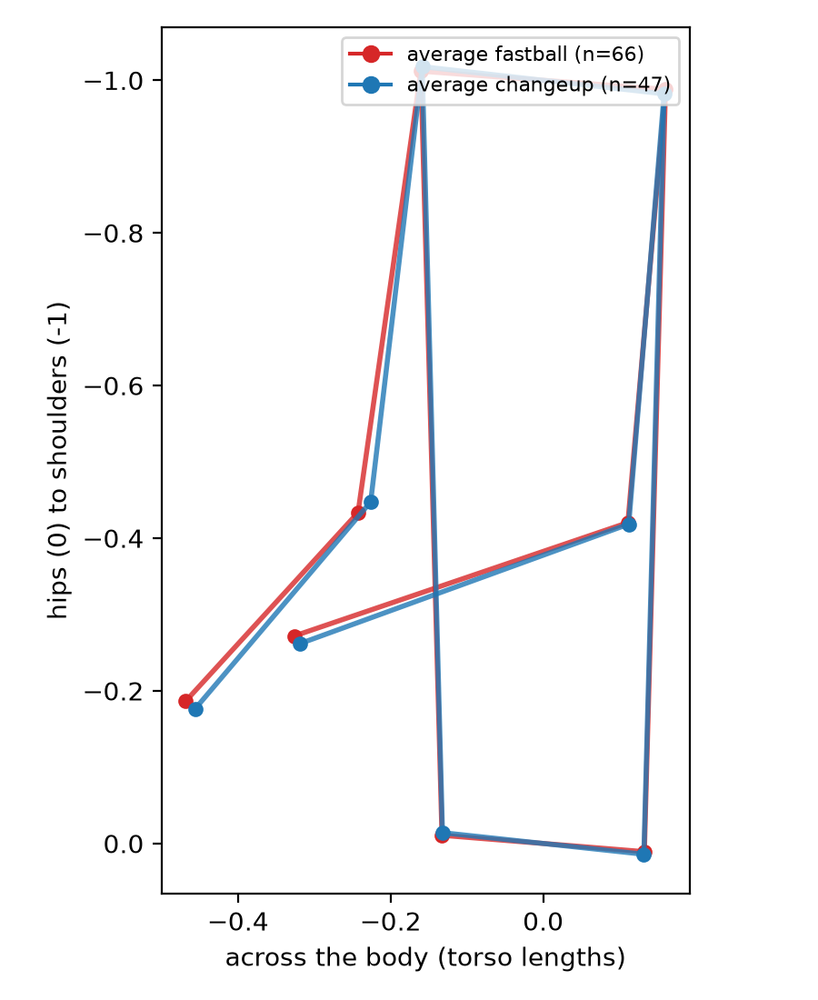

**Challenges**

The main difficulty was obtaining a comparable still frame for every pitch.

- **Set-frame detection.** Pitchers who pause at the top of the leg lift
  produce a second still interval, which the detector initially selected.
- **Camera zoom.** Broadcast zoom varies within a game and blurred the
  averaged images until each frame was scaled to the pitcher's height.
- **Variation between games.** Lighting, uniforms and ballparks differ, so
  averaging and subtraction are done within a single game.

**Future work**

The same method could be applied at other points in the delivery, such as
leg-lift height and release point. Dynamic features are a further step:
the tempo of the leg lift, or the speed of the arm during the delivery.

The pipeline is light enough to process every start, which would support a
running database of suspected tells, including cases where a pitcher later
corrects one.

## Tools

- Python, with OpenCV and NumPy for the image work
- A YOLOv8 detector from [BaseballCV](https://github.com/BaseballCV/BaseballCV)
  to find the pitcher, and YOLO11 pose for the skeleton
- Clips from Baseball Savant, and pitch labels from Statcast through
  [pybaseball](https://github.com/jldbc/pybaseball)

Most of it ran on a laptop GPU, an RTX 4060, with a rented Google Cloud GPU
for larger batches. Preparing a game takes about two minutes there, so 120
games took about two hours.

## Usage

Requires Python 3.12.

```
pip install -r requirements.txt
python run.py "Eduardo Rodriguez" --dates 2026-08-21 2026-08-26 2026-09-01
```

Omitting `--dates` uses the pitcher's three most recent starts of the
current season. The command downloads the clips (about 500 MB per start),
scores the windup and the stretch separately, and writes a report to
`reports/` for each stance with enough pitches.

A GPU is recommended. The default install uses CPU PyTorch; for an NVIDIA
GPU, install the CUDA build afterwards:

```
pip install torch==2.14.0 torchvision==0.29.0 --index-url https://download.pytorch.org/whl/cu126
```

| File | Purpose |
|---|---|
| `tell/set_frames.py` | Set-frame detection |
| `tell/crops.py` | Alignment on the pitcher |
| `tell/gates.py` | Removal of frames that are not a true set position |
| `tell/scoring.py` | Difference image and scoring on separate starts |
| `tell/pose.py` | Pose-based variant |
